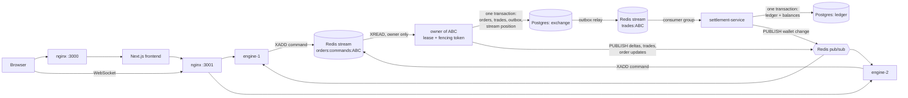

# Mini Exchange

A limit-order exchange built on the starter repository: price-time matching with one active owner
per instrument, failover between engine instances, exactly-once settlement into a double-entry
ledger, a live order book with sequence numbers and client resync, and a chaos test.

- [Run it](#run-it)
- [Architecture and data path](#architecture-and-data-path)
- [Order book consistency](#order-book-consistency)
- [Failover](#failover)
- [Exactly-once settlement](#exactly-once-settlement)
- [Problems found in the starter](#problems-found-in-the-starter)
- [Chaos test](#chaos-test)
- [Why Redis](#why-redis)
- [Breaking changes](#breaking-changes)
- [Not done, or done differently next time](#not-done-or-done-differently-next-time)

## Run it

```bash
docker compose up -d --build        # or docker-compose up --build with the standalone Compose
```

| What | URL |
|---|---|
| Frontend | http://localhost:3000 |
| Matching engine API (nginx in front of two engines), Swagger | http://localhost:3001, http://localhost:3001/docs |
| Settlement API, Swagger | http://localhost:3002, http://localhost:3002/docs |

Ports 3000, 3001 and 3002 must be free. Register on http://localhost:3000/login; a new account
starts with 100,000 USD and 1,000 of each instrument (`ABC`, `DEF`, `XYZ`). The operations panel
(order books and the settlement queue) is for admins: register, then run the command below and sign
in again.

```bash
docker compose exec matching-engine-1 node dist/tools/grant-admin.js you@example.com
```

Every service has a `.env.example`, which compose loads. Secrets are not in it: on the first start
a one-off `secrets` service generates them per installation. Any service, the frontend included,
started in production with a `change-me-*` placeholder from `.env.example` refuses to start, and so
does a frontend without `FRONTEND_PROXY_KEY`, which would sign cookies with a key of its own. Every
Redis command a book, an order submission, the outbox relay or a lease depends on has a timeout, so
a Redis that stops answering is treated as a failure and retried rather than waited on forever. A
relay batch whose `EXEC` timed out may still reach the stream later and be published twice;
settlement books each trade once, so that only costs a duplicate event. Postgres queries in both
services stop after `DATABASE_STATEMENT_TIMEOUT_MS` (60 s; migrations run without it, however they
are started, and reconciliation uses its own pool of 8 connections limited by `RECONCILIATION_STATEMENT_TIMEOUT_MS`,
10 minutes), and lock waits after `DATABASE_LOCK_TIMEOUT_MS` (10 s, the engine's migrations included). A Postgres
that stops answering altogether, dead or frozen, is given up on 5 s after the statement limit: the
query fails, its connection is closed and left out of the pool, so a stalled database shows up as a
stuck book within about 65 s. The gateway does not wait that long: it gives up on an engine after
4 s (8 s under `/auth/`, 70 s for `/trades/summary`) and answers 503 itself, with the body an engine
would send, so a client sees 503 whether an engine or the gateway gave up. Timeouts count against an
engine, so a few within 2 s can take both out of rotation for the API for 2 s; requests are then
answered 503 at once, also those that need no Postgres. WebSocket connections have their own
upstream and are not affected. A `COMMIT` is the one statement waited on
however long it takes (TCP keepalive still finds a dead connection, after the kernel's minutes),
since giving up on it would not tell whether it happened. A commit can still end unknown: when the
connection breaks after the `COMMIT` was sent, the book reloads its state from Postgres, an order
or a rotation is retried under the same key or attempt, and a sign-out is simply sent again.
Refresh and sign-out wait at most 2 s for the user's session lock and answer 503 after 5 s in all,
well inside the gateway's 8 s. On sign-in and refresh 503 means nothing changed: a rotation or a
repeated rotation answered 503 rolls back instead of committing later, so a retry works, and one
whose `COMMIT` has started is waited for, not answered 503. There are two exceptions. Ending a family
caught reusing a token always commits, even after the client was answered 503, so slowing the
database down cannot keep a stolen token alive. A sign-out can answer 503 after the session ended,
when the note in Redis could not be written yet; the answer then carries `code: SESSION_ENDED`, the
frontend drops the cookies, and signing out again is safe. If the `COMMIT` of a rotation outlasts the
gateway the outcome is unknown, so a client that
retries should send `attempt` to `/auth/refresh`, as the frontend always does: without it the retry
counts as reuse and ends the session. A book that is stopped waits 15 s for its batch, then lets the fence
stop it; whatever that batch or a reload still does afterwards no longer touches the book in memory,
so a newer owner on the same engine is never overwritten. Reconciliation checks one period at a
time and lets the next check start only once every query of the previous one finished, which keeps
three connections free for the rest of a run. A period is moved to the back of the queue before it is
checked again; a run that cannot note that, or cannot take a period that matches again off the list,
says so in `recheckError` and is `incomplete`. `replay-check` runs without a statement limit. A
command stream that fails three reads in a row also marks its book stuck, counted in
`book_read_failures_total`. nginx passes a request on to the other engine only when the first one
never received it, or for reads and cancels (`DELETE` is idempotent to nginx), so an order is never
sent twice by the gateway; a cancel may be, which is harmless, since a cancel of an order that is
already cancelled answers 202. A trade summary is never passed on to the other engine, whatever went
wrong: it is the heaviest query of a reconciliation, and open-source nginx cannot tell a connection
that never opened from one that broke halfway. A run that meets a dead engine is `incomplete` and the
next run repeats the period. Only the last index migration, on `refresh_sessions`, builds its
index concurrently. Such a build waits for every older transaction of the database, which blocks no
reads or writes, so it may wait `DATABASE_INDEX_LOCK_TIMEOUT_MS` (10 minutes) instead of the usual
lock limit. A settlement migration that waits for a table lock holds up every read and write of that
table behind it, so it waits only `MIGRATION_LOCK_TIMEOUT_MS` (1.5 s). A lock timeout (`55P03`) is
retried for `MIGRATION_LOCK_RETRY_MS` (10 minutes) after pauses that grow to 15–30 s, so a migration
behind a long reconciliation stops writes for 1.5 s out of every 15–30 s, not all the time. One that a failed build left invalid is dropped and built again on the next run, and a
follow-up migration does the same for an install that had already recorded the first one as done.
The earlier ones took a write lock on their table while it was small.

`/metrics` of each service needs its internal key, as `x-internal-key` or `Authorization: Bearer`:

```bash
docker compose exec settlement-service sh -c '. /run/exchange/secrets.env; wget -qO- --header "x-internal-key: $SETTLEMENT_INTERNAL_KEY" localhost:3002/metrics'
```

**Sessions.** Signing out, or reusing a refresh token, ends the refresh session, refuses its access
token at once (a note in Redis for 30 minutes, twice the life of an access token, checked by both
services and by every WebSocket connection) and closes its WebSocket connections. The ended session
is recorded in Postgres in the same transaction, and every engine retries the Redis note until it is
written. A sign-out answers 503 until the note is written, since an access token is refused only
through that note (a Redis that refuses writes but still answers reads would otherwise let it work
for up to 15 minutes); signing out again finishes it. Expired refresh sessions are deleted when an engine starts and hourly after that, skipping rows another engine is deleting; a stopping engine cancels a cleanup still running instead of waiting for it, and the cleanup keeps its connection until the cancel went through, so the cancel cannot reach a request that got that connection next. After its Redis subscription comes back an engine checks which
connected sessions ended, and keeps checking until Redis answers instead of closing every connection. A rotation and a sign-out of the same user take one
Postgres advisory lock, so a sign-out never misses a refresh token that a parallel rotation is
saving. Refresh and sign-out are not counted against the sign-in limit, and the page reports a
sign-out that did not go through instead of pretending it did; if the engine refuses an access
token that looked valid, the frontend rotates it and signs out with the new one, so the refresh
session ends too. Each sign-in gets its own pair of cookie names (`mx_access_<id>`,
`mx_refresh_<id>`). The id is signed with `FRONTEND_PROXY_KEY`, so a cookie with a made-up name is
ignored, however it sorts, and every value carries a signature over the id and its token, so a name
cannot be moved onto another token. With `COOKIE_SECURE=true`, which any deployment over HTTPS should
set, the names start with `__Host-` and the cookies live on `/`, so a browser takes them only from
this host over HTTPS and a neighbouring subdomain or a plain HTTP response cannot plant one. Plain
HTTP cannot have that guarantee, so the default for `http://localhost` is the signed names alone, on
`/api`, and a production start without `COOKIE_SECURE=true` warns: a whole pair from another sign-in
could still be planted there. Such a pair cannot take a session over: the page keeps the id of its own
sign-in, given at sign-in and by `/api/auth/session` and remembered for the next page load, sends it
with every request as `x-session-id`, and the frontend uses exactly that pair of cookies instead of
the newest. Only a page that knows no sign-in yet gets the newest.

A sign-in ends on the engine every session the browser forgets, and a sign-out every older one. Their
cookies go only after the engine answered that the session is over, within 2 s; otherwise they stay,
a sign-in lists them in `mx_ending`, a cookie signed with `FRONTEND_PROXY_KEY`, and the next request
of another session tries again alongside its own call, so no session is left for its 7 days. That
request only clears the cookies of what it ended: only a sign-in or a sign-out writes the list, so a
request that crosses a sign-in cannot drop what the sign-in listed. A sign-out that cannot end an
older session answers 503, or that session would take over. Apart from that list `/api/auth/session`
and the other routes never end a session, and only the frontend can sign the list, so a planted cookie
cannot end a real session through a page load. Cookies of older formats (without an id, with an unsigned id or value, without the prefix
once `COOKIE_SECURE=true` is on) are never used; sign-in, sign-out and `/api/auth/session` end their
sessions by the same rule and clear them on `/` and `/api`.

All tabs share the cookies, so a sign-in or sign-out reaches the other tabs through a
`BroadcastChannel`, and a tab checks its session when it gets focus, at most every 30 s. In case a
tab hears neither, the frontend answers 409 to a request for a sign-in the browser no longer has, so
a stale tab cannot trade, cancel or read on an account it does not show. The page then checks at once
and moves to the newest sign-in, and a socket asking for a ticket stops asking. A check that fails is
repeated once, and a signal that arrives during a check causes one more check, so news is not lost.
A tab asks about a sign-in another tab announced, but its requests keep the id of the account it shows
until the answer is on screen, so nothing is sent for an account the page does not show yet. Once
that question is answered, even with another sign-in because the announced one is already over, the
tab stops asking about it, unless a newer announcement came in meanwhile.
A page keeps nothing of the account before it, and `/login` sends someone signed in onward. A session that turns out to be over is cleared only under the names the
request was sent with, so a late answer for an old session cannot clear a sign-in that replaced it,
while a dead session is still forgotten at once; the page also ignores refusals of requests sent
before the latest change of session. A refusal of the session the page shows sends it to the sign-in
card at once, and the page then checks whether the browser holds another sign-in, so a tab refused
in the middle of a sign-in elsewhere moves to it, even when the refusal overtook a check already on
its way. A service that refuses an access token just rotated means the
session is over: its cookies are cleared and the new pair is ended, not stored. The attempt id of a rotation is
an HMAC of the cookies and the browser, so a retry always repeats it, whatever happened in between,
without keeping anything in memory that other sessions could push out. An order
answer only changes the stored attempt of the same send, and while an order is still on its way
any other form for it can neither discard nor resend it. Every form of a tab shares one copy of
the attempt in memory, which `sessionStorage` only mirrors for a reload, so a browser that refuses
to store it still keeps the warning and the key. A refresh token a newer rotation already replaced
is answered 409, and the frontend keeps the cookies and answers 503, so a late request cannot sign
out a session that moved on. A wrong password on `/login` does not sign out the session already open,
a sign-in ends the loading state of a session check still retrying, and orders and balances that
loaded stay shown when reloading them fails. A successful answer is shown unless a newer one already
was, even while a newer reload is running, and only the latest reload sets or clears the error, so a
late failure cannot hang an error over fresh data. A quantity typed while an order is on its way
stays when that order is accepted, even the same number typed again. The answer to an order or a cancel is shown only to the user who
sent it, toasts on screen go away when the signed-in user changes, and a session that ended goes
straight to the sign-in card without a toast. Recent trades stay shown when reloading them fails too,
and the wallet's "Updated" time is when the request started, since the balances are no newer. A
Cancel button comes back after 5 s if the order is still open. The frontend's API refuses any
request another site makes the browser send, reads included, since a read may rotate the session;
every page forbids being framed.

## Architecture and data path



1. `POST /orders` on any engine validates the order, checks the `Idempotency-Key`, appends a
   command to `orders:commands:<instrument>` and answers `202 {orderId}`. Redis runs with
   `appendfsync always`, so a 202 means the command is on disk.
2. The owner of the instrument reads the stream in order and matches each batch in memory.
3. It commits the batch in one Postgres transaction: changed orders, trades, outbox rows and the id
   of the last applied command. The first statement checks its fencing token.
4. After the commit it publishes book deltas with a sequence number, trades and order updates
   through Redis pub/sub, and reads the next batch only once they are out; every engine forwards
   them to its own WebSocket clients. An owner that dies between commit and publish loses those
   messages, so every new owner of a book first tells all clients to reload it and their orders.
5. The outbox relay moves each trade to `trades:<instrument>`.
6. Settlement reads that stream through a consumer group and books the trade in one transaction.
7. It publishes the wallet change of both sides and only then acknowledges the event; each owner
   gets a `wallet` event over WebSocket.

## Order book consistency

**Single writer per instrument.** All orders of an instrument go through one Redis stream, and only
the instance that holds the instrument's lease reads it. Matching therefore happens in one place, in
the order the commands sit in the stream, with no lock around matching that would only "mostly"
serialise concurrent requests.

**What the broker guarantees.** A Redis stream gives every entry a strictly increasing id at
`XADD`, so the order of entries is the order in which Redis accepted the commands. That is the
arrival order the exchange commits to, and every replay sees the same order. Before `XADD` there is
no order: two requests still travelling through nginx and two engines can reach Redis either way
round. The `202` is sent only after `XADD`, so a client that waits for it gets its own orders
matched in its own order.

**Order of trade events.** Each instrument's trades go to its own stream in commit order: the
outbox relay runs on one instance at a time and publishes in id order. Settlement does not depend on
that order, since postings only add to or subtract from balances.

**Determinism.** Time priority uses a per-instrument `seq`, not wall clocks; an order's time and a
trade's time come from the stream id, and trade ids are derived from the order id. Replaying a
stream gives the same trades, ids and book, and the tests compare the stored state with a replay.

**Exactly-once application.** The stream position is committed in the same transaction as the
orders and trades it produced, so a new owner resumes after the last committed command. After any
failed batch the owner reloads its state from Postgres and matches nothing until that succeeds.

**Persistence.** Every batch is committed, which is stricter than periodic persistence: the book in
memory always equals the open orders in Postgres, and any instance can rebuild it.

## Failover

| Setting | Value |
|---|---|
| Lease TTL (`LOCK_TTL_MS`) | 5 s |
| Renewal (`LOCK_RENEW_INTERVAL_MS`) | every 1.5 s |
| Acquisition attempts (`LOCK_ACQUIRE_INTERVAL_MS`) | every 1 s |

**Who detects a dead owner.** No one has to: the owner keeps its lease alive by renewing it, a lease
that is not renewed expires on its own, and every instance tries to acquire free instruments every
second. Acquire, renew and release are atomic Lua scripts.

**Split brain.** A TTL alone does not stop an owner that froze and wakes up after someone else took
over. Two mechanisms do:

- **Fencing token.** Acquiring increments a counter in Redis. The new owner raises
  `instrument_state.fence` to its token before it reads the book, and every commit starts with
  `UPDATE instrument_state … WHERE fence = <my token>`. A stale owner updates zero rows, rolls back
  and steps down, so nothing it computed reaches the database.
- **Local deadline.** Before each commit an owner checks that its monotonic clock still leaves the
  lease a margin of `max(TTL / 5, 200 ms)`, and stops if not. A commit that runs past the lease is
  still stopped by the fencing token.

**Expected downtime of an instrument.**

| Event | Expected maximum | Measured by the chaos test |
|---|---|---|
| Owner killed (`kill -9`) | ~7 s: lease expiry ≤ 5 s, acquisition ≤ 1 s, loading the book | 5.0–5.8 s |
| Owner frozen past its lease | the same; the zombie is rejected when it wakes | 6.1–6.8 s |
| Owner stopped (`SIGTERM`) | ~1 s: it finishes its batch, then releases the lease | 1.3–1.5 s |

During the downtime the API keeps accepting orders. They wait in the stream and the new owner
applies them in order, so no accepted order is lost or applied twice.

## Exactly-once settlement

The engine writes each trade to an outbox in the same transaction as the trade; a relay copies it
to `trades:<instrument>`. A crash between the two steps publishes it again, so delivery is at least
once. Settlement books a trade in one transaction:

1. Insert `ledger_transactions(reference = 'trade:<tradeId>')`, which has a unique index, with
   `ON CONFLICT DO NOTHING`. If the row exists, this is a redelivery: the stored trade is compared
   with the event, which is acknowledged as a duplicate, or dead-lettered if the details differ.
2. Record the trade in `settled_trades`.
3. Post four double-entry lines: the buyer pays USD and receives the asset, the seller the opposite.
4. Update the balances in sorted account order, so concurrent trades cannot deadlock.

The event is acknowledged only after the commit and the wallet announcement. If settlement dies in
between, another consumer reclaims the event, step 1 finds the reference, and the money does not
move again. A trade that keeps failing is retried until it was delivered `CONSUMER_MAX_DELIVERIES`
times and is older than `CONSUMER_GIVE_UP_AFTER_MS` (an hour), then dead-lettered with the last
error; reconciliation shows it as unsettled. Once the cause is fixed, put those dead letters back on
their streams; settling twice is impossible, so replaying is safe. Malformed events and trades that
conflict with a settled one stay dead-lettered unless named with `--id`, since replaying them changes
nothing:

```bash
docker compose exec settlement-service sh /opt/secrets/with-secrets.sh node dist/consumer/replay-dead-letters.js [--id <dead-letter id>]
```

**Reconciliation** checks that every ledger transaction balances, every balance touched in the
period equals its entries, every trade has the right four entries, and that the engine's trade count, quantity and
`Σ price × quantity` per instrument equal the ledger's count, quantity and USD moved. It looks at
one period: the trades executed in it, the ledger transactions created in it, and the accounts
they touched. A run without `from` checks at most one day (`RECONCILIATION_STEP_HOURS`), starting
where the last run ended, or at the first trade either service knows of. No period ends later than
a minute ago or than the oldest trade that is not settled yet: a command a book has not applied, a
trade still in the engine's outbox, or one waiting in settlement's consumer group (only its
undelivered and unacknowledged trades are read, at most `RECONCILIATION_BACKLOG_LIMIT`, 10 000 by
default, per stream; past that the run is `incomplete`). A trade carries
the time its order entered the stream, so a book or a queue that lags behind could still add trades
to a period checked earlier. The engine is asked first and settlement's queue after it, so a trade that leaves the outbox
meanwhile is still seen, and the end of the period is fixed before either is asked. If either cannot
say what it has not finished, the run is `incomplete` and does not move on; while something the
checkpoint is already past is unfinished, a run says there is nothing new to check and names what it
waits for (the engine, settlement, or the error it got) instead of checking anything again. A period
cut short of the `to` it was asked for says why in `endedEarly`, and a `from` past that point is
answered as `incomplete` with the reason. Settlement waits for the engine's totals for
`ENGINE_TIMEOUT_MS` (75 s), longer than the gateway (70 s), and the gateway longer than the engine
lets a query run, so a slow period gets its answer instead of ending `incomplete`. A period that does not match is saved in the same
transaction as the checkpoint and checked again, ten per run within a minute, those checked longest
ago first, until it matches; the report lists them under `unresolved` with their count in
`unresolvedTotal` and stays `mismatch` meanwhile; a period that matches again is left out of both
even if its removal failed or its answer was lost. That every asset adds up to zero over all accounts
is a check of the whole ledger, not of a period: a run that finds it broken is `mismatch` and lists
it under `assetsNotBalanced`, but no period is blamed or kept for it, so an old error does not pile
up, and a run is clean again once the ledger is. An account with an old error in it is still found
by every period that touches that account, since a balance has no history to compare a period with.
A saved checkpoint does not lose the report: if the unresolved periods or the totals cannot be read
afterwards, the run says so and is `incomplete`. A run with nothing new to check still adds up the
whole ledger. The operations panel keeps the last result next to a refresh that failed and marks its
badge stale. Pages that ask for a run while one is going get its
report instead of starting another. The operations panel waits up to five minutes for a run and gives
up on an answer that does not come. So a
trade that never got settled keeps showing up, the next days are still checked, a clean history is
not checked again, and no run scans everything. Pass `from` and `to` for any other period. Run it as `GET /admin/reconciliation` (admins) or:

```bash
docker compose exec settlement-service sh /opt/secrets/with-secrets.sh node dist/reconciliation/reconcile.js
```

**Indexes** for reconciliation and access checks:

| Table | Index | Used by |
|---|---|---|
| `orders` | primary key `id` | cancel, which looks an order up by id and owner |
| `orders` | `(ownerId, createdAt)`, and the same where active | a user's finished and active orders |
| `orders` | `(instrument, seq)` where open | loading a book, snapshots |
| `trades` | unique `(instrument, seq)`, `(executedAt)` | trade feed, engine totals |
| `outbox` | `(id)` where unpublished, `(publishedAt)` where published | the relay, purging old messages |
| `users` | unique `(email)`, `(lower(email))` | sign-in |
| `accounts` | unique `(ownerId, asset)` | a user's wallet, posting |
| `ledger_transactions` | unique `(reference)`, `(createdAt)` | idempotent settlement, reconciliation by period |
| `ledger_entries` | `(transactionId)`, `(accountId)` | reconciliation of transactions and balances |
| `settled_trades` | primary key `tradeId`, `(executedAt)`, `(instrument, executedAt)` | redelivery check, reconciliation by period |

## Problems found in the starter

Each problem was first reproduced by a failing test in its own commit and fixed in the commits after
it. The `proof/*` branches keep those commits with their CI runs.

| # | Problem | How it was confirmed | Fix | Proof |
|---|---|---|---|---|
| 1 | **Fake test.** `self-trade.spec.ts` only checked `expect(result).toBeTruthy()`, which passes whatever the matcher does. | The rewritten test fails against a matcher that lets an owner trade with itself | The test checks that no trade happens and that the next counterparty still trades | `proof/matcher-core` |
| 2 | **Concurrent orders on one book.** Matching ran in request handlers on a shared in-memory book: orders arriving together were lost or double-filled, cancelled orders came back, a cancel naming another instrument left the order matchable, filled orders stayed open in the database, the book was lost on restart, and a retried request created a second order. | `starter-bugs.int-spec.ts`: one test per symptom, all failing before the fix | Command stream per instrument with a single writer, batch commits, required `Idempotency-Key` | `proof/command-log` |
| 3 | **IDOR on cancel.** `DELETE /orders/:id` cancelled any user's order. | "does not let a user cancel someone else's order" | Only the owner can cancel; another user's order gives 404 | `proof/command-log` |
| 4 | **The lock.** It was not wired into order processing, had no TTL, so a killed owner held its instrument forever, released with a non-atomic `GET` then `DEL`, and every replica got the same `INSTANCE_ID`. | `failover.int-spec.ts`, `ownership-identity.spec.ts` | Lease with TTL and renewal in Lua, per-process identity, shutdown hooks, fencing token | `proof/ownership` |
| 5 | **Silent stale client.** Book messages had no sequence number and `broadcastDepth` was never called, so a subscriber never saw updates and could not tell. | `realtime.int-spec.ts` | A snapshot and numbered deltas plus a heartbeat with the current `seq`. The client marks the book `stale` on a gap, a heartbeat ahead of it or silence, and fetches a new snapshot; the page shows `live`, `reconnecting` or `stale` | `proof/realtime` |
| 6 | **Floating-point money.** `0.001` became zero and large values lost digits. | `matcher-precision.spec.ts`, `order-validation.spec.ts` | Decimal strings in the API, BigInt fixed-point matching | `proof/matcher-core` |
| 7 | **Counterparty leak.** `POST /orders` returned trades with both user ids. | "returns only the order id and status" | Returns `{orderId, status}` | `proof/matcher-core` |
| 8 | **Did not start cleanly.** A lint error broke the frontend build, `dist/main` was missing, an entity column had no type, and `synchronize: true` fails when two engines start together. | Compose smoke in CI | Fixes plus migrations run by a one-off `migrate` service | `proof/startup` |
| 9 | **Settlement not implemented.** | `settlement.int-spec.ts` | See [Exactly-once settlement](#exactly-once-settlement) | `proof/settlement` |
| 10 | **No rate limit, default secrets, open CORS.** | `platform.int-spec.ts` | Rate limits in Redis shared by instances, required secrets, CORS allow-list | `proof/platform` |

The starter came with two tests: `matcher.spec.ts` is unchanged and green, and `self-trade.spec.ts`
was rewritten because it tested nothing (problem 1).

## Chaos test

To reproduce it:

```bash
docker compose down -v
docker compose -f docker-compose.yml -f docker-compose.chaos.yml up -d --build
node scripts/chaos/run.mjs              # writes chaos-report.md
```

`docker-compose.chaos.yml` only raises the rate limits. It also runs in CI as the `chaos` job.

Eight workers place orders for ten traders on all three instruments, about 150 a second, and retry
with the same `Idempotency-Key` on a timeout, a 5xx or a 429. While the load runs:

| | Scenario |
|---|---|
| A | `kill -9` the engine that owns `ABC` |
| B | `docker pause` the owner of `DEF` for 8 s, longer than the lease, then resume it |
| C | `SIGTERM` the owner of `XYZ` |
| D | `kill -9` settlement for 5 s while trades keep coming |

After the load stops and the queues drain, it checks that:

- every order that got a 202 is stored exactly once, and nothing else is stored;
- the engines applied every command in the streams;
- a replay of every stream gives the same trades and the same outcome for every order;
- reconciliation is `ok` and every trade was settled once;
- each takeover finished within 10 s, 10 s and 3 s, measured by a probe order sent straight to the
  new owner;
- the resumed zombie in B stepped down instead of writing.

**Before the fixes** the starter could not run the test at all: settlement was not implemented and
concurrent orders were lost. Scenario A was reproduced on its own with the starter lock wired in
(`a376930` in `proof/ownership`):

| | Observed |
|---|---|
| Owner `engine-a` running | `lock:instrument:ABC = engine-a`, `PTTL -1`: the lock never expires |
| 30 s after `kill -9 engine-a` | Still `engine-a`, `PTTL -1`; `engine-b` never took `ABC` over |
| A buy against a resting sell after the kill | Accepted but never matched within 15 s |
| `SIGTERM` instead of `kill -9` | The same: the order sent after the stop was never stored |

**After the fixes**, three local runs:

| | Run 1 | Run 2 | Run 3 |
|---|---|---|---|
| A. `kill -9`: new owner / probe order committed | 5.1 s / 5.5 s | 4.9 s / 5.4 s | 4.9 s / 5.3 s |
| B. pause past the lease: new owner / probe order committed | 5.7 s / 6.2 s | 5.7 s / 6.2 s | 6.1 s / 6.6 s |
| C. `SIGTERM`: new owner / probe order committed | 1.1 s / 1.5 s | 1.0 s / 1.4 s | 0.8 s / 1.3 s |
| D. settlement settling again after its restart | 1.3 s | 1.2 s | 1.2 s |
| Orders accepted and stored exactly once | 9,759 | 9,524 | 8,972 |
| Replay, reconciliation, nothing left unapplied | pass | pass | pass |

## Why Redis

Redis Streams is the order log and Redis is the coordinator.

- **Ordering.** A stream per instrument is a partition per instrument with a total order inside,
  which is what one order book needs. Kafka gives the same with more to run; RabbitMQ gives no
  replayable log.
- **Replay.** A stream keeps its entries, so a new owner resumes from a committed position and a
  checker can replay everything.
- **Consumer groups** give settlement at-least-once delivery with acknowledgements and reclaiming.
- **Atomic locks.** Lua scripts make the lease atomic. etcd or ZooKeeper would add consensus, but
  the fencing check in Postgres makes correctness independent of it.
- **One dependency.** The same Redis carries pub/sub for the book and the shared rate limits.

## Breaking changes

| Before | After | Why |
|---|---|---|
| `POST /orders` → 201 with trades | 202 with `{orderId, status}` | Orders go through the command stream; trades must not leak counterparties |
| `price`, `quantity` as numbers | Decimal strings, too many decimals gives 400 | No floating-point money |
| No idempotency | `Idempotency-Key` header required | A retried request must not create a second order |
| `DELETE /orders/:id?instrument=` → 200 | `DELETE /orders/:id` → 202; another user's order 404, a finished one 409 | IDOR and ghost orders |
| `GET /orders/book` with a token, raw orders | Public, aggregated levels with `seq`, no owners | Public depth, no data leak |
| WebSocket `book` event | `book_snapshot`, `book_delta`, `book_heartbeat`, `trade`, `resync`, and private `order` and `wallet` | Sequence numbers and resync |
| `POST /auth/login` → 201 | 200, plus `/auth/refresh` and `/auth/logout` | Sessions |
| WebSocket handshake with the access token | A 30-second ticket from `POST /auth/ws-ticket`; access tokens are refused | The page never holds a 15-minute access token. To roll out, update the engines first with `WS_ACCEPT_ACCESS_TOKENS=true` so pages already open still connect, then the frontend (until its engine issues tickets it keeps retrying rather than hand out the access token), then drop the setting |
| `GET /metrics` open | Needs the internal key of the service | Metrics show traffic and internals |
| `GET /orders` returned every order | Every active order and the latest 100 finished ones | Bounded response |
| Any password length | At most 72 bytes | bcrypt compares only 72 bytes |
| Messages in Ukrainian | English | Language of the project |
| Frontend on port 3000 directly | nginx in front of it on port 3000 | Trustworthy client address |
| Postgres on host port 5433, Redis on 6379 | Not published | No passwords, and the command stream trusts its writers |
| Session cookies `mx_access`, `mx_refresh` on `/api` | Signed names and values on `/api`, on `/` with `__Host-` when `COOKIE_SECURE=true` | Everyone signs in once more after this change, and the old sessions are ended; a planted cookie must not pick the session |
| Tokens told apart by which claims they lack | `typ` claim: `access`, `refresh` or `ws`, required by whoever takes the token | A new kind of token cannot pass as an old one. Tokens without `typ` are still taken until the last of them expires, 7 days after this change; then drop `issuedBeforeTypes` in both `token-claims.ts` and the `undefined` case of `isTokenOfType` |
| `POST /auth/register` of a taken email → 409 | 409 only with another password; the same password signs in | A registration whose answer was lost can be repeated |
| `ledger.assetsNotBalanced` in a reconciliation report | `assetsNotBalanced` next to `ledger`, only when something is off | It describes the whole ledger, not the period |

## Not done, or done differently next time

- **Redis is a single point of failure.** Losing its disk loses commands accepted but not yet
  applied. A replicated log (Redis with a replica and `WAIT`, or Kafka) would close that.
- **No load balancing of instruments.** One instance can end up owning all of them.
- **Streams are never trimmed**, to keep a full replay possible; production would trim them after a
  snapshot.
- **No balance reservation.** Balances can go negative.
- **Crossed books within one user.** Self-trade prevention skips the user's own order, so a user's
  buy can rest above their own sell.
- **A blocking failure stops its instrument.** A batch that can never commit, or a command stream
  that fails three reads in a row, is retried and shown as stuck on the operations panel rather than
  skipped. A trade that can never be booked is retried for
  an hour, then dead-lettered and shown as unsettled by reconciliation until it is replayed.
- **Order history** returns the latest 100 finished orders; paging is not built.
- **Registration shows that an email is taken.** Someone trying a taken email with a wrong password
  gets 409. Hiding that takes a confirmation sent by email, which this exchange does not have; signing
  in gives nothing away, and both are held to the sign-in rate limit.
