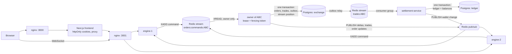

# Mini Exchange

A limit-order exchange built on the starter repository: price-time matching with one active owner
per instrument, failover between engine instances, exactly-once settlement into a double-entry
ledger, reconciliation, a live order book with sequence numbers and client resync, and a chaos test
that kills processes under load.

- [Run it](#run-it)
- [Architecture and data path](#architecture-and-data-path)
- [Order book consistency](#order-book-consistency)
- [Failover](#failover)
- [Exactly-once settlement and reconciliation](#exactly-once-settlement-and-reconciliation)
- [Real-time book and client resync](#real-time-book-and-client-resync)
- [Problems found in the starter](#problems-found-in-the-starter)
- [Chaos test](#chaos-test)
- [Why Redis](#why-redis)
- [Security and platform](#security-and-platform)
- [Tests and CI](#tests-and-ci)
- [Breaking changes](#breaking-changes)
- [Known limitations and what I would do differently](#known-limitations-and-what-i-would-do-differently)

## Run it

```bash
docker compose up -d --build
```

| What | URL |
|---|---|
| Frontend | http://localhost:3000 |
| Matching engine API (nginx in front of two engines), Swagger | http://localhost:3001, http://localhost:3001/docs |
| Settlement API, Swagger | http://localhost:3002, http://localhost:3002/docs |

Compose starts Postgres and Redis, runs the migrations of both databases, then two matching engines
behind nginx, settlement, the frontend and an nginx in front of it. Ports 3000, 3001, 3002, 5433
and 6379 must be free. All of them listen on `127.0.0.1` only.

Register on http://localhost:3000/login; a new account starts with 100,000 USD and 1,000 of every
instrument (`ABC`, `DEF`, `XYZ`). To open the operations panel, put your email into `ADMIN_EMAILS`
in `apps/matching-engine-service/.env.example`, restart the engines
(`docker compose up -d matching-engine-1 matching-engine-2`) and sign in again.

Useful commands:

```bash
./scripts/smoke.sh                                    # end-to-end checks against the running stack
node e2e/browser-smoke.mjs                            # browser scenario (cd e2e && npm ci first; needs a fresh stack)
docker compose -f docker-compose.yml -f docker-compose.chaos.yml up -d --build
node scripts/chaos/run.mjs                            # chaos test, writes chaos-report.md
docker compose exec settlement-service sh /opt/secrets/with-secrets.sh node dist/reconciliation/reconcile.js
docker compose exec matching-engine-1 node dist/tools/replay-check.js
docker compose logs -f matching-engine-1 settlement-service   # JSON logs with traceId
```

Every service has a `.env.example`; compose uses those files for everything except secrets. On the
first start a one-off `secrets` service generates random JWT secrets, the proxy key and the engine's
internal key, one volume per service, and each service mounts and loads only its own keys before
it starts. The placeholders in `.env.example` are for running a service outside compose. Secrets have
no defaults in code: an engine refuses to start without `JWT_ACCESS_SECRET` and
`JWT_REFRESH_SECRET`. `docker compose down -v` drops these volumes, so the next start issues new secrets
and signs everyone out.

## Architecture and data path



The path of one order:

1. `POST /orders` on any engine validates the order, checks the `Idempotency-Key`, appends a
   command to `orders:commands:<instrument>` and answers `202 {orderId}`. Redis runs with
   `appendfsync always`, so a 202 means the command is on disk.
2. The owner of the instrument reads the stream in order and matches each batch in memory.
3. It commits the batch in one Postgres transaction: changed orders, trades, outbox rows and the id
   of the last applied command. The first statement checks its fencing token.
4. After the commit it publishes book deltas, trades and order updates through Redis pub/sub; every
   engine forwards them to its own WebSocket clients.
5. The outbox relay moves each trade to `trades:<instrument>`.
6. Settlement reads that stream through a consumer group, books the trade into the ledger in one
   transaction and only then acknowledges it.
7. Settlement publishes a wallet change, and the owner of the wallet gets a `wallet` event over
   WebSocket.

One trace id follows that path. The id comes from `x-request-id` or is generated, travels in the
command, the trade and the trade event, and every JSON log line on the way carries it. `smoke.sh`
greps one trace id out of the logs of both services:

```text
matching-engine-service  HTTP                POST /orders 202
matching-engine-service  BookRunner:ABC      Applied submit 4b9f… filled
matching-engine-service  BookRunner:ABC      Trade 77a4… executed 1.00000000 @ 10.00
matching-engine-service  OutboxRelayService  Published trade.executed 77a4… to trades:ABC
settlement-service       TradeConsumer…      Trade 77a4… settled from trades:ABC
```

## Order book consistency

**Single writer per instrument.** All orders of an instrument go through one Redis stream, and only
the instance that holds the instrument's lease reads it. Matching therefore happens in exactly one
place, in the order the commands sit in the stream. There is no lock around matching that would only
"mostly" serialise concurrent requests.

**What the broker guarantees.** A Redis stream assigns every entry a strictly increasing id at
`XADD`. The order of entries is the order in which Redis accepted the commands, which is the arrival
order the exchange commits to. Two requests that arrive "at the same time" are ordered by Redis, once,
and every replay sees the same order.

**Determinism.** Time-priority uses a per-instrument `seq`, not wall clocks. An order's `createdAt`
and a trade's time come from the stream id, and trade ids are derived from the order id. Replaying a
stream from scratch therefore produces the same trades, ids and book. The concurrency test and the
chaos test both compare the stored state with such a replay.

**Exactly-once application.** The position in the stream is committed in the same transaction as the
orders and trades it produced. After a crash, a new owner resumes after the last committed command:
a committed command is never applied twice, an uncommitted one is applied once.

**Persistence.** The task allows periodic persistence. This implementation commits every batch,
which is stricter: the book in memory always equals the open orders in Postgres, so any instance can
rebuild it and answer snapshots from the database.

## Failover

| Setting | Value |
|---|---|
| Lease TTL (`LOCK_TTL_MS`) | 5 s |
| Renewal (`LOCK_RENEW_INTERVAL_MS`) | every 1.5 s |
| Acquisition attempts (`LOCK_ACQUIRE_INTERVAL_MS`) | every 1 s |

**Who detects a dead owner.** Nobody needs to: the owner keeps its lease alive by renewing it, and a
lease that is not renewed expires on its own. Every instance tries to acquire free instruments every
second. Acquire, renew and release are Lua scripts, so "check the holder and act" is atomic.

**Split brain.** A TTL alone does not stop an owner that froze, for example in a long GC pause or a
`docker pause`, and wakes up after someone else took over. Two mechanisms stop it:

- **Fencing token.** Acquiring increments a counter in Redis. The new owner raises
  `instrument_state.fence` to its token before it reads the book, and every commit starts with
  `UPDATE instrument_state … WHERE fence = <my token>`. A stale owner updates zero rows, rolls back
  and steps down. Nothing it computed reaches the database.
- **Local deadline.** An owner stops committing when its own monotonic clock says the lease is
  about to expire (with a safety margin of `max(TTL / 5, 200 ms)`), before anyone else can hold it.

**Expected downtime of an instrument.**

| Event | Expected | Measured by the chaos test (three runs) |
|---|---|---|
| Owner killed (`kill -9`) | up to ~7 s: lease expiry ≤ 5 s, acquisition ≤ 1 s, loading the book | 4.0 s, 5.2 s, 4.7 s |
| Owner frozen past its lease | same as a kill, the zombie is rejected when it wakes | 7.8 s, 7.8 s, 7.4 s |
| Owner stopped gracefully (`SIGTERM`) | about 1 s: the owner releases its lease on shutdown | 1.2 s, 1.0 s, 1.2 s |

During the downtime the API keeps accepting orders. They wait in the stream and the new owner
applies them in order, so no accepted order is lost or applied twice.

## Exactly-once settlement and reconciliation

**At-least-once delivery.** The engine writes each trade to an outbox table in the same transaction
as the trade. A relay copies outbox rows to `trades:<instrument>` and marks them published. A crash
between the two steps publishes the trade again, so the event may arrive more than once.

**Idempotent processing at the settlement boundary.** Settlement books a trade in one transaction:

1. Insert `ledger_transactions(reference = 'trade:<tradeId>')`, which has a unique index, with
   `ON CONFLICT DO NOTHING`. If the row already exists, this is a redelivery: the stored trade is
   compared with the event, and the event is either acknowledged as a duplicate or dead-lettered
   if the details differ.
2. Record the trade in `settled_trades`.
3. Post four double-entry lines: the buyer pays USD and receives the asset, the seller the
   opposite. Every asset sums to zero within the transaction.
4. Update the balances, always in sorted account order, so concurrent trades between the same
   users cannot deadlock.

The event is acknowledged (`XACK`) only after the commit. If settlement dies between the commit and
the acknowledgement, another consumer reclaims the event after `CONSUMER_RETRY_IDLE_MS`, step 1 sees
the existing reference, and the money does not move again. Malformed events and conflicting trade
ids go to `settlement:dead-letter`; any other failure is retried without a limit, so a database
outage never dead-letters a valid trade.

**Reconciliation** (`GET /admin/reconciliation` for admins, or `reconcile.js`) checks:

- every ledger transaction sums to zero per asset;
- every balance equals the sum of its entries, and every asset sums to zero across accounts;
- every trade has exactly four entries with the right owners, assets and signs;
- for every instrument, the engine's trade count, quantity and `Σ price × quantity` over the period
  equal the ledger's count, quantity and USD actually moved.

The result is `ok`, `mismatch` (with the offending rows) or `incomplete` when the engine is
unreachable. By default it skips the last minute, so trades still on their way are not reported as
missing.

### Indexes

Every query used for access checks and reconciliation has an index:

| Table | Index | Used by |
|---|---|---|
| `orders` | `(ownerId, createdAt)` | a user's own orders, ownership check on cancel |
| `orders` | `(instrument, seq)` where open | loading a book, snapshots |
| `trades` | unique `(instrument, seq)`, `(executedAt)` | trade feed, engine totals for reconciliation |
| `outbox` | `(id)` where unpublished | the relay |
| `accounts` | unique `(ownerId, asset)` | a user's wallet, posting |
| `ledger_transactions` | unique `(reference)` | idempotent settlement |
| `ledger_entries` | `(transactionId)`, `(accountId)` | reconciliation of transactions and balances |
| `settled_trades` | primary key `tradeId`, `(executedAt)`, `(instrument, executedAt)` | redelivery check, reconciliation by period |

## Real-time book and client resync

- On `subscribe` a client gets `book_snapshot`: aggregated levels and the book's `seq`, read from
  Postgres in one REPEATABLE READ transaction. After that it gets `book_delta` messages with
  `seq + 1`, `seq + 2`, … containing only the levels that changed. A level with quantity zero has
  left the book.
- The owner announces the current `seq` every 2 s in `book_heartbeat`.
- `seq` lives in Postgres, so it does not restart on failover.

The client side is a pure reducer (`apps/frontend/lib/book/reducer.ts`, unit tested):

- deltas that arrive before the snapshot are buffered, and only those newer than the snapshot are
  applied;
- a gap in `seq`, a heartbeat ahead of the book, or seven seconds without hearing anything mark the
  book **stale** and request a new snapshot;
- a lost connection shows **reconnecting**, and the book is replaced by a fresh snapshot after
  reconnecting.

The page shows `live`, `reconnecting` or `stale` and never keeps showing an old book as live. The
browser test forces a resync with a heartbeat ahead of the book and drops the WebSocket by stopping
nginx.

## Problems found in the starter

Each problem was first reproduced by a failing test in its own commit, then fixed in the next one.
The `proof/*` branches keep those commits with their CI runs, so the red run is visible next to the
fix.

| # | Problem | How it was confirmed | Fix | Proof |
|---|---|---|---|---|
| 1 | **Fake test.** `self-trade.spec.ts` only checked `expect(result).toBeTruthy()`, which passes whatever the matcher does. | Rewritten test fails against a matcher that lets an owner trade with itself | The test checks that no trade happens and that the next counterparty still trades | `proof/matcher-core` |
| 2 | **Concurrent orders on one book.** Matching ran inside request handlers on a shared in-memory book: orders arriving together were lost or double-filled, cancelled orders came back, a cancel naming another instrument left the order matchable, filled orders stayed open in the database, the book was lost on restart, and a retried request created a second order. | `starter-bugs.int-spec.ts`: one test per symptom, all failing before the fix | Command stream per instrument with a single writer, batch commits, required `Idempotency-Key` | `proof/command-log` |
| 3 | **IDOR on cancel.** `DELETE /orders/:id` cancelled any user's order. | "does not let a user cancel someone else's order" | Only the owner can cancel; another user's order gives 404, a finished one 409, a malformed id 400 | `proof/command-log` |
| 4 | **The lock.** It was not wired into order processing at all. It had no TTL, so a killed owner would hold its instrument forever. Release was a non-atomic `GET` then `DEL`, the service quit its Redis client before releasing on shutdown, and every replica would get the same `INSTANCE_ID` from `.env.example`. | `failover.int-spec.ts` and `ownership-identity.spec.ts` fail before the fix: a killed or stopped owner never hands over, processes share an identity | Lease with TTL and renewal in Lua, per-process identity, shutdown hooks, fencing token | `proof/ownership` |
| 5 | **Silent stale client.** Book messages had no sequence number, and `broadcastDepth` was never called, so a subscriber never saw updates. The book exposed order owners and required a token. | `realtime.int-spec.ts` fails before the fix | Snapshot and numbered deltas fanned out through Redis, public aggregated book, heartbeat, client resync | `proof/realtime` |
| 6 | **Floating-point money.** Prices and quantities were JS numbers: `0.001` became zero and large values lost digits. | `matcher-precision.spec.ts`, `order-validation.spec.ts` | Decimal strings in the API, BigInt fixed-point matching | `proof/matcher-core` |
| 7 | **Counterparty leak.** `POST /orders` returned trades with both user ids. | "returns only the order id and status, never trades or counterparties" | Returns `{orderId, status}` | `proof/matcher-core` |
| 8 | **Did not start cleanly.** A lint error broke the frontend build, `dist/main` was missing because tests were compiled into the build, an entity column had no type, and `synchronize: true` fails when two engines start together. | Compose smoke in CI | Fixes plus migrations run by a one-off `migrate` service | `proof/startup` |
| 9 | **Settlement not implemented.** | `settlement.int-spec.ts` fails before the fix | See settlement above | `proof/settlement` |
| 10 | **No rate limit, default secrets, open CORS.** | `platform.int-spec.ts` fails before the fix | Rate limits in Redis shared by instances, required secrets, CORS allow-list. Compose generates the secrets on first start (see below) | `proof/platform` |

### Found in a later review

These were not in the starter; they came up in a review of the finished code. The tests named below
fail without the fix.

| Problem | How it was confirmed | Fix |
|---|---|---|
| **An instrument could hang with no book running.** If renewing failed while a book was still loading (a slow database), the owner dropped the lease but the book started anyway. When the same instance acquired the instrument again, `startInstrument` kept the stale book, which was fenced out on its first command. The instance then held and renewed the lease with nothing processing the stream, so no other instance could take over. | `ownership-lifecycle.spec.ts`: "does not keep a book running after losing the lease while it was starting" | The owner stops a book that finished loading after the lease was lost, and a new token replaces a running book instead of being ignored |
| **The concurrency test compared the engine with itself.** It replayed the stream through the same `applyCommands`, so a matching bug would be reproduced by the replay. | Breaking the trade price, the time priority or self-trade prevention in the matcher still passed it | A separate, deliberately naive price-time reference. 40 random command streams in unit tests and the concurrent flow are checked against it, plus "no crossed book between different owners" |
| **A snapshot that never arrived left the book stale for good.** Nothing asked again after a lost reply, for example when the database failed during `subscribe`. | `reducer.test.ts` | The client asks again after 5 s without a snapshot |
| **The trade feed could skip trades and the order list could go back.** Trades that arrived while the list was loading were dropped, and gaps in the trade `seq` went unnoticed. A reload could replace a filled order with an older open version. | `feeds.test.ts` | Trades are buffered until the list loads and merged by id; a skipped `seq` reloads the list; an order only moves forward |
| **Two sign-ups with one email at once gave a 500**, and login skipped the hash check for unknown emails, so timing showed which emails had accounts. | `auth.int-spec.ts`, `auth-login.spec.ts` | 409 on the unique violation; a dummy hash is checked for unknown emails |
| **`/trades/summary` was public.** Anyone could make the engine total every trade in a period, 100 times a second. | `trade-summary.int-spec.ts` | It needs the engine's internal key, which reconciliation sends |
| **Compose ran with the published placeholder secrets** and exposed the APIs on every interface. Anyone who read the repository could sign a token for any user or as an admin, or pick their own address for the sign-in limit with the proxy key. | Reading `docker-compose.yml` and `.env.example` | Secrets generated per installation, ports on `127.0.0.1` |

## Chaos test

`scripts/chaos/run.mjs` runs against the compose stack (`docker-compose.chaos.yml` only raises rate
limits and names an admin) and runs in CI as the `chaos` job.

**Load.** Eight workers place orders for ten traders on all three instruments, about 150 a second,
priced so most of them trade. On a timeout, a 5xx or a 429 a worker retries with the same
`Idempotency-Key`, as a real client would.

**Scenarios**, one after another while the load runs:

| | Scenario |
|---|---|
| A | `kill -9` the engine that owns `ABC` |
| B | `docker pause` the owner of `DEF` for 8 s, longer than the lease, then resume it |
| C | `SIGTERM` the owner of `XYZ` |
| D | `kill -9` settlement for 5 s while trades keep coming |

**Checks after the load stops and every queue has drained:**

- every order that got a 202 is stored exactly once, and nothing else is stored;
- the engines applied every command in the streams;
- `replay-check` rebuilds every book from its stream: same trades, same open orders;
- reconciliation is `ok` and the number of settled trades equals the number of trades;
- each takeover finished within its limit (10 s, 10 s, 3 s);
- the resumed zombie in B stepped down instead of writing.

**Before the fixes** the starter could not even run this test: a killed owner kept its instrument
forever (the failing test is in `proof/ownership`), settlement was not implemented, and concurrent
orders were lost (`proof/command-log`).

**After the fixes**, three consecutive local runs:

| | Run 1 | Run 2 | Run 3 |
|---|---|---|---|
| A. `kill -9`: new owner / processing again | 3.9 s / 4.0 s | 4.9 s / 5.2 s | 4.6 s / 4.7 s |
| B. pause past the lease: new owner / processing again | 6.1 s / 7.8 s | 4.2 s / 7.8 s | 5.7 s / 7.4 s |
| C. `SIGTERM`: new owner / processing again | 0.9 s / 1.2 s | 1.0 s / 1.0 s | 0.9 s / 1.2 s |
| D. settlement settling again after its restart | 1.3 s | 1.3 s | 1.2 s |
| Orders accepted and stored exactly once | 10,456 | 10,049 | 9,147 |
| Replay, reconciliation, nothing left unapplied | pass | pass | pass |

In B the gap between the new owner and the first commit is mostly the load generator: nginx keeps
sending about half the requests to the frozen instance, they wait for the client's timeout, and fewer
commands arrive. See the limitations below.

## Why Redis

Redis Streams is the order log and Redis is the coordinator.

- **Ordering.** A stream per instrument is a partition per instrument with a total order inside it,
  which is exactly what one order book needs. Kafka would give the same with more machinery to run.
  RabbitMQ does not give a replayable log.
- **Replay.** A stream keeps its entries, so a new owner resumes from a committed position and a
  checker can replay everything.
- **Consumer groups.** These give settlement at-least-once delivery with acknowledgements, a pending
  list and reclaiming, so no extra broker is needed.
- **Atomic locks.** Lua scripts make lease acquisition, renewal and release atomic. The fencing token
  closes the gap that a TTL lease alone leaves open. etcd or ZooKeeper would add consensus that
  Redis does not have, but the fencing check in Postgres makes correctness independent of that.
- **One dependency.** The same Redis also carries pub/sub for the book and the shared rate limits.

## Security and platform

- **Authentication.** JWT access tokens (15 min) and refresh tokens (7 days) that rotate on use.
  Reusing an old refresh token ends the session. Logout revokes the refresh token. Admins are the
  emails in `ADMIN_EMAILS`, re-evaluated at every sign-in.
- **Frontend.** Tokens live only in httpOnly, `SameSite=lax` cookies, and the browser talks to
  Next.js route handlers that forward the token. Sign-in redirects only to paths inside the app.
  The WebSocket handshake carries a short-lived access token, and the socket is closed when that
  token expires.
- **IDOR.** Orders and wallets are always looked up by the token's user. A WebSocket client cannot
  join another user's room.
- **Validation.** DTOs with whitelisting everywhere. Prices and quantities are decimal strings
  within column precision, only listed instruments are accepted, ids must be UUIDs.
- **Rate limits.** Shared by both engines through Redis:

  | Scope | Limit | Counted per |
  |---|---|---|
  | Orders | 20 / s | user |
  | Sign-in | 10 / min | address |
  | Public endpoints | 100 / s | address |
  | Book snapshots over WebSocket | 10 / 10 s | socket |

  The nginx gateways overwrite `X-Forwarded-For` so a client cannot pick its own address. The
  frontend passes the user's address with a shared key. Sign-in and orders answer 503 rather than
  skipping the limit while Redis is down.
- **Secrets and internal calls.** Compose generates the secrets on first start, and each service
  sees only its own. The engine's trade summary, used by reconciliation, needs an internal key.
  Unknown emails still cost a password-hash check at sign-in, so timing does not reveal accounts.
- **Observability.**
  - JSON logs with a trace id end to end.
  - Prometheus `/metrics` and `/health` on both services.
  - `/ops/status` for admins: owners, fences, stream backlog, outbox, consumer lag, dead letters.
  - An operations page in the frontend for admins.
- **API docs.** Swagger at `/docs` on both services.

## Tests and CI

| Where | What |
|---|---|
| `apps/matching-engine-service/test` | Unit tests: matcher, precision, validation, self-trade, depth, apply-commands, ownership, random command streams against an independent price-time reference |
| `apps/matching-engine-service/test/int` | Against real Postgres and Redis, including spawned engine processes: starter bugs, concurrency against a replay and the reference, fencing, failover, real-time across instances, auth, rate limits, tracing, ops, replay check |
| `apps/settlement-service/test` | Unit tests: postings, idempotent handling of trade events; integration: redelivery, crash before `XACK`, concurrent trades, reconciliation |
| `apps/frontend/lib` | Book resync reducer, trade feed and order list merging, decimals, safe redirect |
| `scripts/smoke.sh` | The whole compose stack, from a trade to both wallets, reconciliation, one trace id, 429s, forged headers, docs |
| `e2e/browser-smoke.mjs` | Playwright: sign-up, a live order, the book, a forced resync, a reconnect, the wallet |
| `scripts/chaos/run.mjs` | The chaos test above |

CI runs lint, typecheck, unit tests and build for every service. It also runs both integration
suites against Postgres and Redis service containers, the compose smoke with the browser test, and
the chaos test.

The starter came with two tests. `matcher.spec.ts` is unchanged and green. `self-trade.spec.ts` was
rewritten because it tested nothing (problem 1).

## Breaking changes

| Before | After | Why |
|---|---|---|
| `POST /orders` → 201 with trades | 202 with `{orderId, status}` | Orders go through the command stream; trades must not leak counterparties |
| `price`, `quantity` as numbers | Decimal strings, too many decimals gives 400 | No floating-point money |
| No idempotency | `Idempotency-Key` header required | A retried request must not create a second order |
| `DELETE /orders/:id?instrument=` → 200 | `DELETE /orders/:id` → 202; another user's order 404, a finished one 409 | IDOR and ghost orders |
| `GET /orders/book` with a token, raw orders | Public, aggregated levels with `seq`, no owners | Public depth per the task, no data leak |
| WebSocket `book` event | `book_snapshot`, `book_delta`, `book_heartbeat`, `trade`, and private `order` and `wallet` | Sequence numbers and resync |
| `POST /auth/login` → 201 | 200, plus `/auth/refresh` and `/auth/logout` | Sessions |
| Messages in Ukrainian | English | Language of the project |
| Frontend on port 3000 directly | nginx (`web`) on port 3000 in front of it | Trustworthy client address |

## Known limitations and what I would do differently

- **Redis is a single point of failure.** Losing Redis's disk loses commands that were accepted but
  not yet applied. A replicated log (Redis with a replica and `WAIT`, or Kafka) would close that.
- **No uneven-load balancing.** Instruments are not spread evenly, and one instance can end up
  owning all of them.
- **A frozen owner slows the API down.** nginx keeps sending about half the requests to the frozen
  instance until they time out (60 s at nginx, 3 s in the chaos client). A short read timeout for
  the REST API with a retry on the other engine would fix that. Retrying is safe because of the
  `Idempotency-Key`.
- **Streams are never trimmed.** This keeps a full replay possible; production would trim them
  after a snapshot.
- **No balance reservation.** Balances can go negative.
- **Crossed books within one user.** Self-trade prevention skips the user's own resting order, so
  a user's buy can rest above their own sell. Other users still trade against both.
- **Book contract for clients.** A `book_delta` may arrive before the `book_snapshot`; clients
  buffer and drop deltas with `seq` not above the snapshot.
- **Lost `wallet` notifications.** If settlement dies between its commit and the notification, the
  event is lost. The money is right, and the client re-reads the wallet when it reconnects.
- **Sessions.**
  - An access token stays valid until it expires (15 min) after logout.
  - Two simultaneous refreshes with the same token end the session; the frontend serialises them.
- **Rate limits.** They use fixed windows, so a burst of up to twice the limit is possible across a
  window boundary.
- **Email collisions.** An email that would collide with another account after lowercasing stays as
  it was and needs a manual merge.
- **Public endpoints.** `/metrics`, `/health` and `/docs` need no authentication.
- **`replay-check`** compares only what the engine has applied, in one consistent snapshot, so it
  can run against a live system. Commands still waiting are reported separately.
