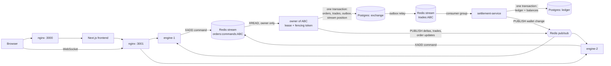

# Mini Exchange

A limit-order exchange built on the starter repository: price-time matching with one active owner
per instrument, failover between engine instances, exactly-once settlement into a double-entry
ledger, a live order book with sequence numbers and client resync, and a chaos test.

- [Run it](#run-it)
- [Architecture and data path](#architecture-and-data-path)
- [Order book consistency](#order-book-consistency)
- [Failover](#failover)
- [Exactly-once settlement](#exactly-once-settlement)
- [Real-time book and resync](#real-time-book-and-resync)
- [Security](#security)
- [Observability](#observability)
- [Problems found in the starter](#problems-found-in-the-starter)
- [Chaos test](#chaos-test)
- [Why Redis](#why-redis)
- [Breaking changes](#breaking-changes)
- [Not done, or done differently next time](#not-done-or-done-differently-next-time)

## Run it

```bash
docker compose up -d --build        # or docker-compose up --build
```

| What | URL |
|---|---|
| Frontend | http://localhost:3000 |
| Matching engine API (nginx in front of two engines), Swagger | http://localhost:3001, http://localhost:3001/docs |
| Settlement API, Swagger | http://localhost:3002, http://localhost:3002/docs |

Ports 3000, 3001 and 3002 must be free. Register on http://localhost:3000/login; a new account
starts with 100,000 USD and 1,000 of each instrument (`ABC`, `DEF`, `XYZ`). The operations panel
(order books, the settlement queue, reconciliation) is for admins: register, run the command below
and sign in again.

```bash
docker compose exec matching-engine-1 node dist/tools/grant-admin.js you@example.com
```

Every service has a `.env.example`, which compose loads. Secrets are not in it: on the first start
a one-off `secrets` service generates them per installation, and a service started in production
with a `change-me-*` placeholder refuses to start.

**Tests.** Unit tests need nothing; integration tests need Postgres on port 55432 and Redis on 56379:

```bash
docker run -d --name mx-int-pg -p 127.0.0.1:55432:5432 -e POSTGRES_USER=exchange -e POSTGRES_PASSWORD=exchange -e POSTGRES_DB=exchange postgres:16-alpine
docker run -d --name mx-int-redis -p 127.0.0.1:56379:6379 redis:7-alpine

cd apps/matching-engine-service && npm ci && npm test && npm run test:int
cd apps/settlement-service && npm ci && npm test && npm run test:int
cd apps/frontend && npm ci && npm test
```

CI (`.github/workflows/ci.yml`) runs lint, typecheck, unit and integration tests of every service,
a browser smoke test against the compose stack and the chaos test on every push and pull request.

## Architecture and data path



1. `POST /orders` on any engine validates the order, checks the `Idempotency-Key`, appends a command
   to `orders:commands:<instrument>` and answers `202 {orderId}`. Redis runs with
   `appendfsync always`, so a 202 means the command is on disk.
2. The owner of the instrument reads the stream in order and matches each batch in memory.
3. It commits the batch in one Postgres transaction: changed orders, trades, outbox rows and the id
   of the last applied command. Before it writes anything it checks its fencing token.
4. After the commit it publishes book deltas with a sequence number, trades and order updates through
   Redis pub/sub; every engine forwards them to its own WebSocket clients.
5. The outbox relay moves each trade to `trades:<instrument>`.
6. Settlement reads that stream through a consumer group and books the trade in one transaction.
7. It publishes the wallet change of both sides and only then acknowledges the event; each owner gets
   a `wallet` event over WebSocket.

## Order book consistency

- **Single writer per instrument.** All commands of an instrument go through one Redis stream, and
  only the instance holding the instrument's lease reads it. Matching happens in one place, in stream
  order, with no lock around request handlers that would only "mostly" serialise them.
- **What the broker guarantees.** `XADD` gives every entry a strictly increasing id, so the order of
  entries is the order in which Redis accepted the commands. That is the arrival order the exchange
  commits to, and every replay sees the same order. Before `XADD` there is no order: two requests
  still travelling through nginx can reach Redis either way round. A client that waits for its 202
  gets its own orders matched in the order it sent them.
- **Determinism.** Time priority uses a per-instrument `seq`, not wall clocks; trade ids are derived
  from the order id. Replaying a stream gives the same trades, ids and book, and the tests compare
  the stored state with a replay.
- **Exactly-once application.** The stream position is committed in the same transaction as the
  orders and trades it produced, so a new owner resumes after the last committed command. After a
  failed batch the owner reloads its state from Postgres before matching anything.
- **Persistence.** Every batch is committed, which is stricter than periodic persistence: the book in
  memory always equals the open orders in Postgres, and any instance can rebuild it.
- **Self-trade prevention.** An order that reaches a resting order of its own owner stops there: what
  it traded with better-priced counterparties stays, and the rest is cancelled. It never trades with
  itself and never rests across its owner's order, so the book is never crossed.
- **Cancels.** A cancel goes through the stream of the order it names and is applied after that
  order. An order that got its 202 may still wait in the stream when its cancel arrives; its
  instrument is noted in the same Redis transaction as its `XADD` (kept 24 h), so the cancel still
  reaches the right stream. A filled order answers 409, a partly filled one is cancelled in the
  rest and keeps its filled part, and another user's order answers 404.

## Failover

| Setting | Value |
|---|---|
| Lease TTL (`LOCK_TTL_MS`) | 5 s |
| Renewal (`LOCK_RENEW_INTERVAL_MS`) | every 1.5 s |
| Acquisition attempts (`LOCK_ACQUIRE_INTERVAL_MS`) | every 1 s |

**Who detects a dead owner.** No one has to: an owner keeps its leases alive by renewing them, a
lease that is not renewed expires on its own, and every instance tries to acquire free instruments
every second. Each lease is renewed and acquired on its own, so one slow instrument holds up no
other. Acquire, renew and release are atomic Lua scripts.

**Split brain.** A TTL alone does not stop an owner that froze and wakes up after someone else took
over:

- **Fencing token.** Acquiring increments a counter in Redis. The new owner raises
  `instrument_state.fence` to its token before it reads the book, and every batch runs
  `UPDATE instrument_state … WHERE fence = <my token>` before it writes anything. A stale owner
  updates zero rows, rolls back and steps down, so nothing it computed reaches the database.
- **Local deadline.** Before each commit an owner checks on its monotonic clock that the lease still
  has a margin of `max(TTL / 5, 200 ms)`, and stops if not.
- **No batch outlives the lease.** A batch may sit idle in its transaction no longer than the lease
  TTL, so an owner frozen mid-batch loses its transaction and its row lock, and the new owner is not
  held up.

**Expected downtime of an instrument.**

| Event | Expected maximum | Measured by the chaos test, locally and in CI |
|---|---|---|
| Owner killed (`kill -9`) | ~7 s: lease expiry ≤ 5 s, acquisition ≤ 1 s, loading the book | 5.2–5.5 s |
| Owner frozen past its lease | the same; the zombie is rejected when it wakes | 6.2–6.6 s |
| Owner stopped (`SIGTERM`) | ~1.5 s: it finishes its batch, then releases its leases | 1.2–1.5 s |

During the downtime the API keeps accepting orders. They wait in the stream and the new owner applies
them in order, so no accepted order is lost or applied twice.

## Exactly-once settlement

The engine writes each trade to an outbox in the same transaction as the trade; a relay copies it to
`trades:<instrument>`. A crash between the two steps publishes it again, so delivery is at least once.
Settlement makes it exactly once by booking a trade in one transaction:

1. Insert `ledger_transactions(reference = 'trade:<tradeId>')`, which has a unique index, with
   `ON CONFLICT DO NOTHING`. If the row exists, this is a redelivery: it is acknowledged as a
   duplicate, or dead-lettered if its details differ from the settled trade.
2. Record the trade in `settled_trades`.
3. Post four double-entry lines: the buyer pays USD and receives the asset, the seller the opposite.
4. Update the balances in sorted account order, so concurrent trades cannot deadlock.

The event is acknowledged only after the commit. If settlement dies in between, another consumer
reclaims the event, step 1 finds the reference, and the money does not move again. A trade that keeps
failing is retried until it was delivered 20 times and is an hour old (`CONSUMER_MAX_DELIVERIES`,
`CONSUMER_GIVE_UP_AFTER_MS`), then dead-lettered; once the cause is fixed it can be put back safely:

```bash
docker compose exec settlement-service sh /opt/secrets/with-secrets.sh node dist/consumer/replay-dead-letters.js [--id <dead-letter id>]
```

**Reconciliation** checks, for one period at a time, that every ledger transaction balances, every
touched balance equals its entries, every trade has its four entries, and that the engine's trade
count, quantity and `Σ price × quantity` per instrument equal the ledger's. A run without `from`
checks up to a day after the last checked period and never past a trade that is not settled yet. A
period that does not match is kept and checked again until it does. Run it from the operations
panel, as `GET /admin/reconciliation?from=&to=` (admins) or:

```bash
docker compose exec settlement-service sh /opt/secrets/with-secrets.sh node dist/reconciliation/reconcile.js
```

**Indexes** for reconciliation and access checks:

| Table | Index | Used by |
|---|---|---|
| `orders` | primary key `id` | cancel, which looks an order up by id and owner |
| `orders` | `(ownerId, createdAt)`, and the same where active | a user's active and finished orders |
| `orders` | `(instrument, seq)` where open | loading a book, snapshots |
| `trades` | unique `(instrument, seq)`, `(executedAt)` | trade feed, engine totals |
| `accounts` | unique `(ownerId, asset)` | a user's wallet, posting |
| `ledger_transactions` | unique `(reference)`, `(createdAt)` | idempotent settlement, reconciliation by period |
| `ledger_entries` | `(transactionId)`, `(accountId)` | reconciliation of transactions and balances |
| `settled_trades` | primary key `tradeId`, `(executedAt)`, `(instrument, executedAt)` | redelivery check, reconciliation by period |

## Real-time book and resync

- A subscriber gets a `book_snapshot` with the book's `seq`, then a `book_delta` for every change with
  the next `seq`, and a `book_heartbeat` with the current `seq` every 2 s. Trades and the user's own
  order and wallet changes come as `trade`, `order` and `wallet` events.
- The client applies a delta only if its `seq` is exactly the next one. A gap, a heartbeat ahead of
  its `seq`, or silence marks the book `stale`, and the client fetches a new snapshot instead of going
  on with old data. After a reconnect it always starts from a snapshot.
- The page shows the state of the connection: `live`, `reconnecting` or `stale`.
- A new owner that cannot be sure every change was published tells all clients to resync.

## Security

- **Authentication.** JWT access tokens (15 min) and refresh tokens (7 days) with rotation; reusing a
  refresh token or signing out ends the session, and its access token and WebSockets are refused at
  once. The frontend keeps tokens in httpOnly cookies, and the page never sees them; WebSockets
  connect with a 30-second ticket.
- **IDOR.** Orders and wallets are read and changed only for the owner of the token; another user's
  order answers 404, as if it did not exist.
- **Validation.** DTOs with whitelisting on every endpoint; prices and quantities are decimal strings
  with a fixed number of decimals, and one order is worth at most 10^15 USD.
- **Rate limits** in Redis, shared by all instances: orders and cancels 20/s per user, sign-in and
  registration 10/min per IP, public reads 100/s per IP.
- **Browser.** CORS allow-list, cross-site requests to the frontend's API refused, a content security
  policy and no framing.

## Observability

- **Trace ID.** Every request gets an `x-request-id`. It travels with the command through the stream,
  into the trade, the outbox event and settlement, and the engine and settlement log JSON lines with
  it.
- **Metrics.** `/metrics` of each service needs its internal key:

  ```bash
  docker compose exec settlement-service sh -c '. /run/exchange/secrets.env; wget -qO- --header "x-internal-key: $SETTLEMENT_INTERNAL_KEY" localhost:3002/metrics'
  ```

- **Operations panel** (`/ops`, admins): the owner and state of every book, the settlement queue
  (lag, pending, retries, dead letters) and the last reconciliation.

## Problems found in the starter

Each problem was first reproduced by a failing test in its own commit and fixed in the commits after
it. The `proof/*` branches keep those commits with their CI runs.

| # | Problem | How it was confirmed | Fix | Proof |
|---|---|---|---|---|
| 1 | **Fake test.** `self-trade.spec.ts` only checked `expect(result).toBeTruthy()`, which passes whatever the matcher does. | The rewritten test fails against a matcher that lets an owner trade with itself | The test checks that no trade happens, better-priced counterparties still trade, and the rest of the order is cancelled | `proof/matcher-core` |
| 2 | **Concurrent orders on one book.** Matching ran in request handlers on a shared in-memory book: orders arriving together were lost or double-filled, cancelled orders came back, a cancel naming another instrument left the order matchable, filled orders stayed open in the database, the book was lost on restart, and a retried request created a second order. | `starter-bugs.int-spec.ts`: one test per symptom, all failing before the fix | Command stream per instrument with a single writer, batch commits, required `Idempotency-Key` | `proof/command-log` |
| 3 | **IDOR on cancel.** `DELETE /orders/:id` cancelled any user's order. | "does not let a user cancel someone else's order" | Only the owner can cancel; another user's order gives 404 | `proof/command-log` |
| 4 | **The lock.** It was not wired into order processing, had no TTL, so a killed owner held its instrument forever, released with a non-atomic `GET` then `DEL`, and every replica got the same `INSTANCE_ID`. | `failover.int-spec.ts`, `ownership-identity.spec.ts` | Lease with TTL and renewal in Lua, per-process identity, shutdown hooks, fencing token | `proof/ownership` |
| 5 | **Silent stale client.** Book messages had no sequence number and `broadcastDepth` was never called, so a subscriber never saw updates and could not tell. | `realtime.int-spec.ts` | Snapshot, numbered deltas and heartbeats; the client resyncs on a gap ([details](#real-time-book-and-resync)) | `proof/realtime` |
| 6 | **Floating-point money.** `0.001` became zero and large values lost digits. | `matcher-precision.spec.ts`, `order-validation.spec.ts` | Decimal strings in the API, BigInt fixed-point matching | `proof/matcher-core` |
| 7 | **Counterparty leak.** `POST /orders` returned trades with both user ids. | `orders-response.spec.ts` | Returns `{orderId, status}` | `proof/matcher-core` |
| 8 | **Did not start cleanly.** A lint error broke the frontend build, `dist/main` was missing, an entity column had no type, and `synchronize: true` fails when two engines start together. | Compose smoke in CI | Fixes, plus migrations run by a one-off `migrate` service | `proof/startup` |
| 9 | **Settlement not implemented.** | `settlement.int-spec.ts` | See [Exactly-once settlement](#exactly-once-settlement) | `proof/settlement` |
| 10 | **No rate limit, default secrets, open CORS.** | `platform.int-spec.ts` | Shared rate limits in Redis, generated secrets, CORS allow-list | `proof/platform` |
| 11 | **Cancel.** The starter's cancel set any order to `cancelled` with nothing left: a filled order looked cancelled after it had traded, and a partly filled one lost how much of it was filled. Once orders went through the command stream, a cancel sent right after the 202 found nothing in Postgres yet and answered 404, while the order went on to rest and trade. | `cancel.int-spec.ts` | A filled order answers 409, a cancel keeps the filled part, and a cancel of an order still in the stream is applied right after it | `cancel.int-spec.ts` |

The starter came with two tests: `matcher.spec.ts` keeps its tests unchanged and green, and
`self-trade.spec.ts` was rewritten because it tested nothing (problem 1).

## Chaos test

```bash
docker compose down -v
docker compose -f docker-compose.yml -f docker-compose.chaos.yml up -d --build
node scripts/chaos/run.mjs              # writes chaos-report.md
```

`docker-compose.chaos.yml` only raises the rate limits. The test also runs in CI as the `chaos` job.

Eight workers place orders for ten traders on all three instruments, 100–150 a second, and retry
with the same `Idempotency-Key` on a timeout, a 5xx or a 429. While the load runs:

| | Scenario |
|---|---|
| A | `kill -9` the engine that owns `ABC` |
| B | `docker pause` the owner of `DEF` for 8 s, longer than the lease, then resume it |
| C | `SIGTERM` the owner of `XYZ` |
| D | `kill -9` settlement for 5 s while trades keep coming |

After the load stops and the queues drain, it checks that every order that got a 202 is stored
exactly once and nothing else is; the engines applied every command; a replay of every stream gives
the same trades and order outcomes; reconciliation is `ok` and every trade was settled once; each
takeover finished within 10 s (A, B) and 3 s (C); and the resumed zombie in B committed nothing.

**Before the fixes** the starter could not run the test at all: settlement was not implemented and
concurrent orders were lost. Scenario A on its own, with the starter lock wired in (`a376930` in
`proof/ownership`): the lock had no TTL (`PTTL -1`), 30 s after `kill -9` it still named the dead
engine, the other engine never took `ABC` over, and an order sent after the kill was accepted but
never matched. `SIGTERM` gave the same result.

**After the fixes**, three local runs:

| | Run 1 | Run 2 | Run 3 |
|---|---|---|---|
| A. `kill -9`: new owner / probe order committed | 5.1 s / 5.5 s | 4.9 s / 5.4 s | 4.9 s / 5.3 s |
| B. pause past the lease: new owner / probe order committed | 5.7 s / 6.2 s | 5.7 s / 6.2 s | 6.1 s / 6.6 s |
| C. `SIGTERM`: new owner / probe order committed | 1.1 s / 1.5 s | 1.0 s / 1.4 s | 0.8 s / 1.3 s |
| D. settlement settling again after its restart | 1.3 s | 1.2 s | 1.2 s |
| Orders accepted and stored exactly once | 9,759 | 9,524 | 8,972 |
| Replay, reconciliation, nothing left unapplied | pass | pass | pass |

## Why Redis

Redis Streams is the order log and Redis is the coordinator.

- **Ordering.** A stream per instrument is a partition per instrument with a total order inside,
  which is what one order book needs. Kafka gives the same with more to run; RabbitMQ gives no
  replayable log.
- **Replay.** A stream keeps its entries, so a new owner resumes from a committed position and a
  checker can replay everything.
- **Consumer groups** give settlement at-least-once delivery with acknowledgements and reclaiming.
- **Atomic locks.** Lua scripts make the lease atomic. etcd or ZooKeeper would add consensus, but the
  fencing check in Postgres keeps correctness independent of the lock.
- **One dependency.** The same Redis carries pub/sub for the book and the shared rate limits.

## Breaking changes

| Before | After | Why |
|---|---|---|
| `POST /orders` → 201 with trades | 202 with `{orderId, status}` | Orders go through the command stream; trades must not leak counterparties |
| `price`, `quantity` as numbers | Decimal strings; too many decimals gives 400; at most 10^15 USD per order | No floating-point money; balances must not overflow |
| No idempotency | `Idempotency-Key` header required | A retried request must not create a second order |
| `DELETE /orders/:id?instrument=` → 200 | `DELETE /orders/:id` → 202; another user's order 404, a filled one 409 | IDOR and ghost orders |
| `GET /orders` returned every order | Every active order and the latest 100 finished ones; older ones through `GET /orders/history` | Bounded response |
| `GET /orders/book` with a token, raw orders | Public, aggregated levels with `seq`, no owners | Public depth, no data leak |
| WebSocket `book` event | `book_snapshot`, `book_delta`, `book_heartbeat`, `trade`, `resync`, private `order` and `wallet` | Sequence numbers and resync |
| `POST /auth/login` → 201 | 200, plus `/auth/refresh`, `/auth/logout`, `GET /auth/session` | Sessions |
| WebSocket handshake with the access token | A 30-second ticket from `POST /auth/ws-ticket` | The page never holds an access token |
| `GET /metrics` open | Needs the internal key of the service | Metrics show internals |
| Frontend on port 3000 directly, Postgres and Redis published | nginx in front of the frontend; Postgres and Redis not published | Trustworthy client address; the command stream trusts its writers |
| Messages in Ukrainian | English | Language of the project |

## Not done, or done differently next time

- **Redis is a single point of failure.** Losing its disk loses commands accepted but not yet applied.
  A replicated log (Redis with a replica and `WAIT`, or Kafka) would close that.
- **No load balancing of instruments.** One instance can end up owning all of them.
- **Streams are never trimmed**, to keep a full replay possible; production would trim them after a
  snapshot.
- **No balance reservation.** Balances can go negative.
- **A blocking failure stops its instrument.** A batch that can never commit is retried and shown as
  stuck on the operations panel rather than skipped.
